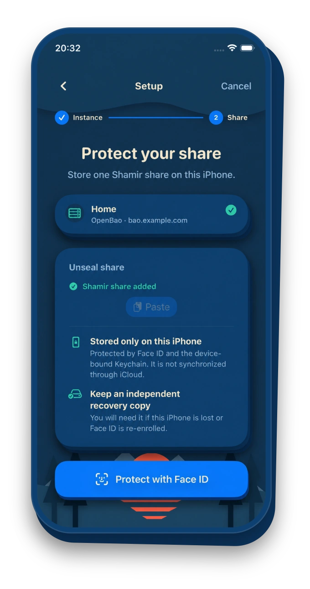
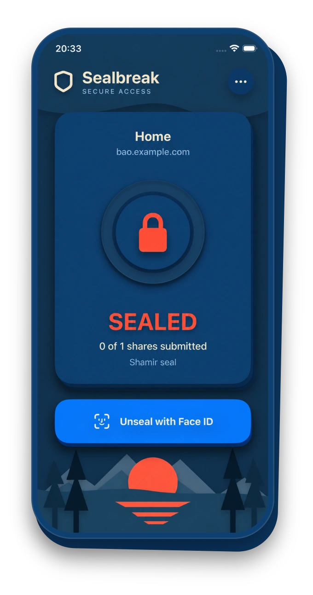
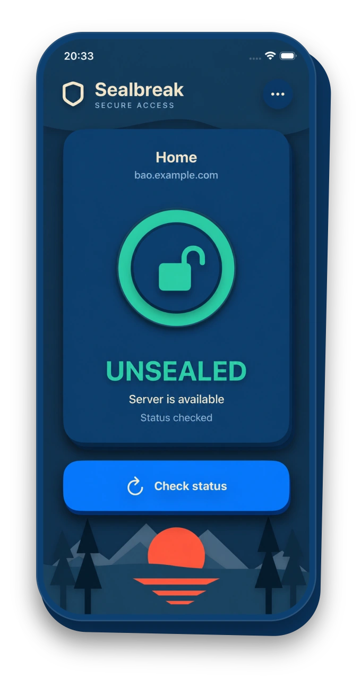

  

<h1 align="center">Sealbreak</h1>

  <strong>Open-source iOS app to securely unseal OpenBao and HashiCorp Vault with Face ID.</strong>

  
  

  <a href="https://sealbreak.app">Website</a>
  ·
  <a href="THREAT_MODEL.md">Threat Model</a>

  

<table align="center">
  <tr>
    <th align="center">Set up once</th>
    <th align="center">Approve with Face ID</th>
    <th align="center">Check the result</th>
  </tr>
  <tr>
    <td align="center">
      
    </td>
    <td align="center">
      
    </td>
    <td align="center">
      
    </td>
  </tr>
</table>

Sealbreak is a small iOS app for securely storing a Shamir unseal share for OpenBao or HashiCorp Vault on your iPhone and submitting it only after explicit Face ID authorization.

## How it works

Configure your OpenBao server and import an unseal share once. When OpenBao needs to be unsealed, open Sealbreak and tap **Unseal**.

Sealbreak confirms that it is communicating with the configured server before requesting Face ID. Only after successful authorization is the device-bound share released and submitted. The app then checks OpenBao again to confirm the resulting state.

## Security

Sealbreak treats the unseal share as sensitive key material rather than a regular app credential. It remains bound to the device and protected by Face ID, without cloud synchronization or an export path.

Security assumptions, design decisions, and known risks are documented openly in the project's [threat model](THREAT_MODEL.md). It provides the basis for reviewing the security of Sealbreak as the project evolves.

## License

Sealbreak is distributed under the [GNU General Public License version 3](LICENSE) (GPL-3.0-only). Its additional Apple App Store distribution permission is in [COPYING.iOS](COPYING.iOS). This does not replace the GPL or grant rights over separately licensed third-party components.

Third-party license and attribution information is in [THIRD_PARTY_NOTICES.md](THIRD_PARTY_NOTICES.md).

### Commercial licensing

Code for which the maintainer has sufficient rights may also be offered under separate commercial or proprietary license terms, including in a closed-source Sealbreak Premium product. The open-source Sealbreak version remains available under GPLv3, and third-party licenses still apply.

### Contributing

See [CONTRIBUTING.md](CONTRIBUTING.md) and the [Harmony Contributor License Agreements](docs/legal/CLA-INDIVIDUAL.md) before submitting code. The project requires additional licensing rights from contributors to support both GPLv3 and proprietary distribution.
