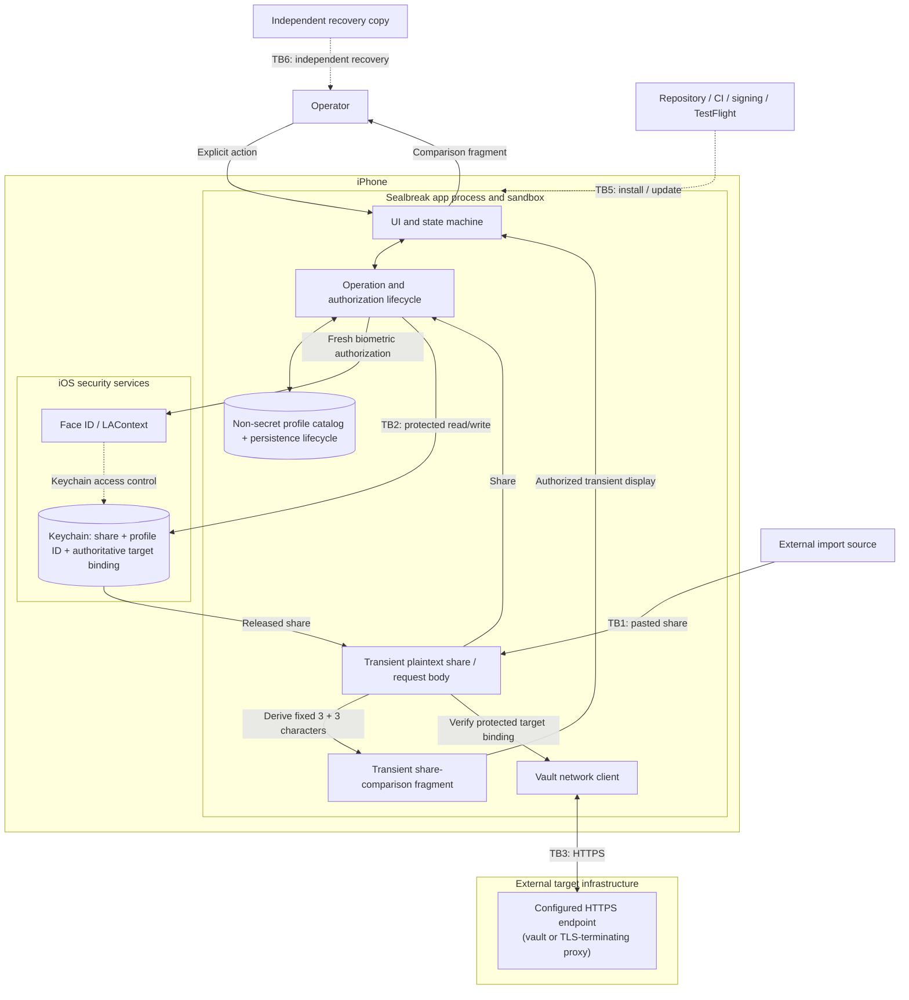
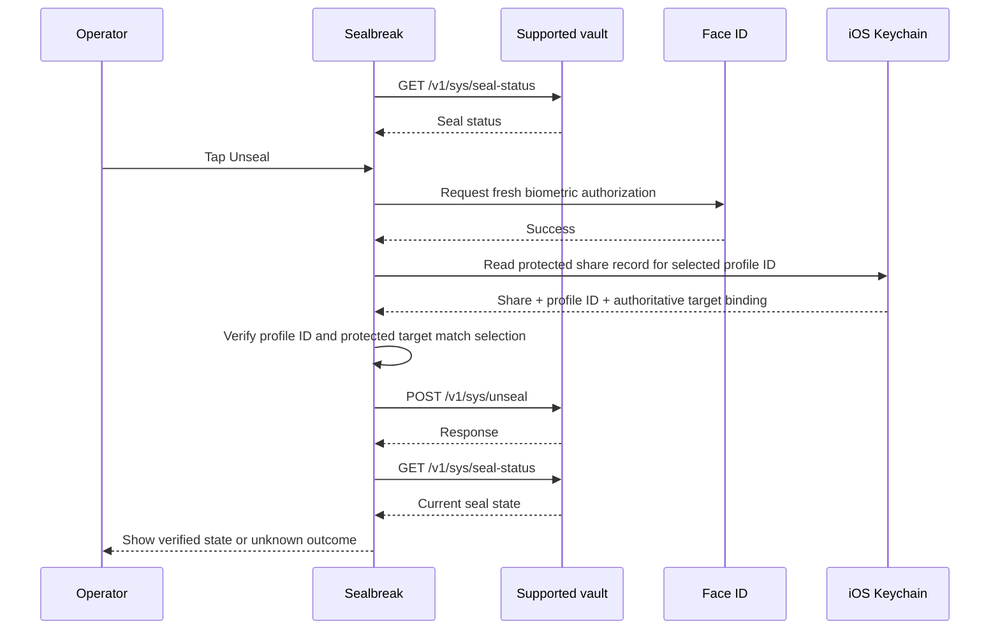
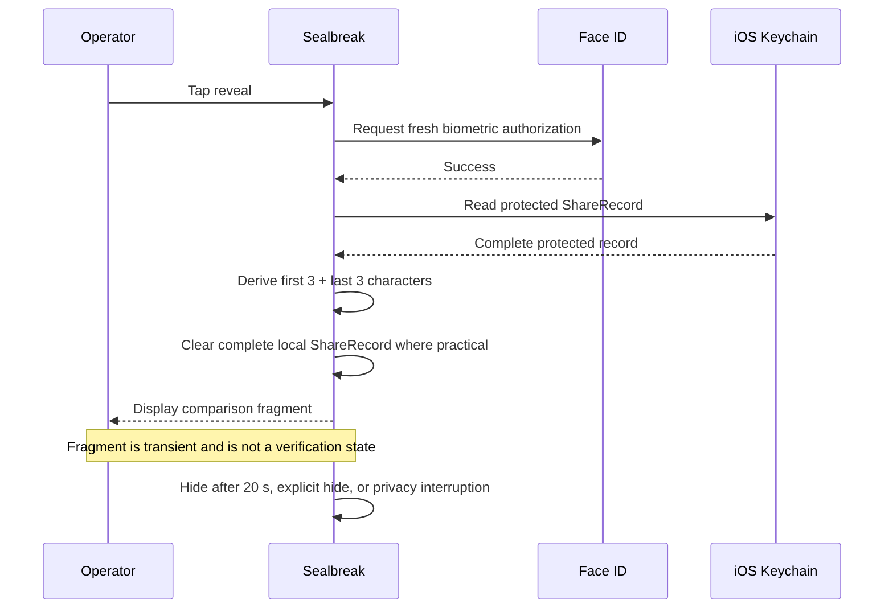

# Sealbreak Threat Model

## 1. Scope, Assets, and Assumptions

### 1.1 Scope

Sealbreak is an iOS application that stores one Shamir unseal share for a supported vault on an iPhone, protects access to that share with Face ID and iOS Keychain controls, and submits the share to one explicitly configured vault endpoint after a current operator action.

Throughout this document, **vault** means a Sealbreak-supported server that is manually unsealed with Shamir shares, currently OpenBao and HashiCorp Vault.

In scope:

- local storage of one Shamir share;
- biometric-authorized display of a minimized share-comparison fragment;
- Face ID authorization and Keychain access control;
- server profile storage and share-to-target binding;
- seal-status checks and manual unseal submission;
- local share replacement and deletion;
- application network behavior;
- the application build, signing, and update path insofar as it affects share confidentiality and integrity.

Out of scope:

- the internal implementation security of supported vault servers;
- transport security beyond TLS termination at the configured HTTPS endpoint;
- general server administration, policy management, and secret browsing;
- auto-unseal and seal migration;
- cloud synchronization of the share;
- protection against an already fully compromised iPhone or developer workstation;
- the security of external recovery copies beyond Sealbreak's requirement that recovery exists independently of the app.

### 1.2 Assets

| ID | Asset | Security objective |
| --- | --- | --- |
| **A01** | Shamir share | Prevent disclosure of the complete share except during explicitly authorized sensitive operations; preserve controlled availability for authorized use; minimize and strictly limit any intentional partial disclosure |
| **A02** | Share-to-server binding | Prevent a stored share from being redirected to another target |
| **A03** | Operator intent | Require a current, explicit operator action before share release or disclosure of share-derived data |
| **A05** | Vault target identity | Prevent submission to an unintended or spoofed endpoint |
| **A06** | Application integrity | Prevent a malicious build or update from stealing an authorized share |

In a 1-of-1 configuration, disclosure of the stored share compromises the full unseal quorum.

### 1.3 Assumptions

| ID | Assumption |
| --- | --- |
| **AN01** | The conservative baseline is a 1-of-1 Shamir configuration |
| **AN02** | The iPhone has a device passcode and Face ID enabled |
| **AN03** | The iPhone is not already fully compromised |
| **AN04** | The configured vault is manually unsealed with Shamir shares |
| **AN06** | An independent recovery copy exists outside the iPhone and Sealbreak |
| **AN07** | Any TLS-terminating proxy is trusted infrastructure because it receives the complete Shamir share in decrypted form |

## 2. Architecture and Trust Boundaries

### 2.1 Data Flow Diagram



### 2.2 Trust Boundaries

| Boundary | Transition | Security relevance |
| --- | --- | --- |
| **TB1** | External import source → Sealbreak | The external source and any copies it retains are outside Sealbreak control |
| **TB2** | App → Keychain / Face ID | iOS must enforce access to the share itself, not merely access to the visible UI |
| **TB3** | iPhone → configured HTTPS endpoint | Authenticate the endpoint and transport; redirects must not retarget the share |
| **TB5** | Repository / CI / signing / TestFlight → installed app | A malicious but validly signed build can misuse a legitimately released share |
| **TB6** | Independent recovery → operator | Recovery must remain usable without the original iPhone, app, or sealed server instance |

### 2.3 Security-Critical Unseal Flow



A successful HTTP response alone is not treated as proof that the configured vault is fully unsealed. Sealbreak re-checks the seal state after submission. If submission may already have reached the server but verification fails, the final outcome is treated as unknown and the app does not retry automatically.

### 2.4 Security-Critical Share Comparison Flow



The Keychain releases the complete protected record after authorization; the fragment is derived inside the app process. The Keychain does not expose only the displayed characters. A matching fragment is therefore a limited manual comparison aid and is not proof that the complete stored share matches an independent copy.

## 3. Threat Analysis — STRIDE

STRIDE covers Spoofing, Tampering, Repudiation, Information Disclosure, Denial of Service, and Elevation of Privilege.

### 3.1 Spoofing

#### T01 — Spoofed vault server

An attacker attempts to make Sealbreak submit a valid share to an unintended endpoint.

Current controls include HTTPS-only canonical origins, normal certificate and hostname validation, rejection of redirects, and validation that the response URL matches the request URL. These controls reduce spoofing or retargeting after a correct endpoint enrollment. They do not protect against a compromised legitimate endpoint and cannot determine whether the operator initially enrolled the intended HTTPS endpoint. The residual score below applies to the post-enrollment spoofing or retargeting case; initial mis-enrollment is an operator configuration failure rather than a transport-control failure.

Affected assets: **A01, A05**

Controls: **M03, M04**

#### T02 — Manipulated target binding

An attacker or corrupted local metadata attempts to associate a stored share with another server.

Each display profile has a stable UUID. The protected Keychain record stores that profile ID and the canonical bound server origin together with the share, but not the display profile itself. The Keychain account is also derived from the profile ID. Before submission, Sealbreak requires both the protected profile ID and protected origin to match the selected profile and aborts on mismatch. Network submission is then built from the protected bound origin, so changing separate display metadata cannot retarget or cross-associate a share.

Affected assets: **A01, A02, A05**

Controls: **M04**

#### T03 — Biometric access-control bypass

An attacker attempts to retrieve or use the stored share without a current biometric authorization.

The Keychain item uses `kSecAttrAccessibleWhenPasscodeSetThisDeviceOnly` with `biometryCurrentSet`. Sealbreak creates a fresh `LAContext` for protected share access and normal modification, requires Face ID, disables application fallback, and invalidates the context when the operation ends. Actual device behavior after Face ID changes, lockout, cancellation, and migration remains dependent on iOS enforcement and should be validated on physical hardware.

Affected assets: **A01, A03**

Controls: **M01, M02**

### 3.2 Tampering

#### T04 — Manipulated or incorrect seal status

Malformed, stale, or attacker-controlled status data could cause the application to present an incorrect state or proceed under false assumptions.

Sealbreak accepts only HTTP 200 JSON responses from the expected URL, bounds response size, decodes into a typed model, and validates basic state consistency. It re-checks status after submission. These controls cannot make a compromised legitimate vault server truthful.

Affected assets: **A03, A05**

Controls: **M05**

#### T05 — Local lifecycle state integrity failure

A failed, interrupted, or partially completed local share operation could leave protected share storage and profile metadata inconsistent, causing the application to treat incomplete state as valid or making recovery harder.

Sealbreak persists a non-ready lifecycle state before operations that could leave the Keychain and profile catalog inconsistent. Only fully committed local state is treated as configured. Interrupted, incomplete, unreadable, unsupported, or otherwise inconsistent local state fails closed into the recovery path instead of reopening normal operation. Replacement updates the existing Keychain item in place, and destructive reset operations establish a persistent recovery state before deleting protected shares. All readers and writers enforce a common encoded-record size limit. Sealbreak still cannot prove that an independent recovery copy exists or is usable.

Affected assets: **A01**

Controls: **M08, M09**

#### T06 — Reuse of a stolen share

A Shamir share is not a one-time credential. An attacker who obtains a copy can submit it again after the vault is resealed without using Sealbreak or Face ID.

Once a share has been copied, app-local authorization, data minimization, and request discipline cannot prevent its reuse outside Sealbreak. The applicable post-compromise response is to replace the compromised share using the supported vault's rekey procedure.

The residual rating covers the complete scenario: obtaining a valid copy of the share and reusing it after reseal before that share is replaced.

Affected assets: **A01**

Controls: **M09**

### 3.3 Repudiation

#### T07 — Weak actor attribution

The vault receives the submitted share but does not receive cryptographic proof that a particular person completed Face ID on a particular iPhone.

Sealbreak therefore does not claim individual server-verifiable attribution. A successful unseal also does not prove which operator completed the quorum.

Affected assets: **A03**

Controls: **M12**

### 3.4 Information Disclosure

#### T08 — Share remains in the import or recovery source

A share may already exist in a password manager, clipboard history, note, screenshot, chat application, terminal, backup, or other external source before Sealbreak imports it. Copies may remain available after import or may already have been synchronized or retained elsewhere.

Current controls limit the Sealbreak import path to an explicit system paste action and clear the current general pasteboard after a pasted value passes share-format validation. Sealbreak provides no share-export functionality. These controls cannot revoke copies retained by the source or already synchronized or stored elsewhere.

Affected assets: **A01**

Controls: **M07, M09**

#### T09 — Share appears in diagnostics

Sensitive data could leak through logs, analytics, crash reports, request dumps, caches, server error reflection, or temporary files.

Sealbreak contains no application analytics or share logging, uses an ephemeral URL session, disables caches, cookies, and credential storage, does not display response bodies on error, and deliberately keeps diagnostic messages coarse. Infrastructure such as TLS proxies and external crash tooling remains outside the app's direct control.

Affected assets: **A01**

Controls: **M06, M12**

#### T10 — Share read from process memory

During setup or replacement, the pasted share exists transiently in process memory before protected storage. After authorization, the stored share also exists in process memory during unseal submission and comparison-fragment derivation. A process-memory compromise could expose the complete share during these periods.

Sealbreak performs best-effort cleanup of mutable buffers and uses short-lived request data, but Swift strings, serialization internals, networking, a debugger, or a sufficiently privileged process attacker may retain or inspect copies. Guaranteed memory erasure is not claimed.

Affected assets: **A01, A06**

Controls: **M01, M02, M06, M07, M11, M13**

#### T11 — Unexpected synchronization, backup, or migration

Incorrect storage configuration could copy the protected share to another device or backup channel.

The Keychain query explicitly disables synchronization and uses `WhenPasscodeSetThisDeviceOnly`. Each protected share uses a profile-scoped Keychain account. The non-secret profile catalog is stored with complete file protection and excluded from backup. Real backup, restore, and device-migration behavior still depends on platform enforcement and should be tested on physical devices.

Affected assets: **A01, A02**

Controls: **M01, M06, M08**

#### T16 — Compromised legitimate vault infrastructure

Sealbreak may connect to the intended hostname with valid TLS while the vault server or TLS-terminating proxy is already compromised. A valid unseal operation would then disclose the share to compromised infrastructure.

This is an architectural trust dependency. Correct TLS validation confirms endpoint identity, not endpoint integrity.

Affected assets: **A01, A05**

Controls: **M10**

#### T18 — Disclosure of a share-comparison fragment

After fresh biometric authorization, Sealbreak intentionally displays a fixed fragment derived from the protected Shamir share. An unauthorized observer or a captured screen may therefore obtain part of the share even though the complete value remains protected.

Repeated reveals expose the same fixed fragment rather than additional portions of the share. The fragment is nevertheless secret-derived data and reduces the confidentiality of the complete share.

Affected assets: **A01, A03**

Controls: **M01, M02, M06, M13**

### 3.5 Denial of Service

#### T12 — Device, Face ID, or application-identity loss

Device loss, hardware failure, Face ID re-enrollment, Keychain invalidation, app deletion, or an application-identity change may make the local share inaccessible.

This is partly an intentional consequence of device-bound storage. Under AN06, loss of the local share is recoverable through the independent recovery copy, although Sealbreak remains unavailable until the operator reprovisions the local share. If that recovery copy is missing or unusable, the impact can become irreversible, but that outcome violates AN06 rather than the baseline T12 scenario.

Affected assets: **A01**

Controls: **M09**

#### T13 — Bootstrap dependency failure

Unseal may depend on DNS, a VPN, certificates, or a TLS proxy that is itself unavailable while the vault is sealed.

Sealbreak has bounded request timeouts and fails closed, but it cannot repair an unavailable dependency. The deployment must ensure that the network path required for unseal does not depend on secrets that are themselves unavailable while the vault is sealed.

Affected assets: **A01, A05**

Controls: **M05, M10**

#### T14 — Wrong cluster node

In a clustered deployment, Shamir unseal progress is node-specific. Requests routed to different nodes can prevent quorum completion or produce misleading progress.

Sealbreak is configured with one explicit origin but does not cryptographically bind requests to a node identity or an unseal attempt. Deployment routing must therefore keep the status and share submissions directed to the intended node.

Affected assets: **A01, A05**

Controls: **M05, M10**

### 3.6 Elevation of Privilege

#### T15 — Malicious application or update

A compromised repository, CI workflow, developer system, signing credential, or distributed application could produce a legitimate-looking Sealbreak build that requests valid Face ID authorization and then copies the released share.

The project has a small dependency surface, but local biometric controls cannot defend against code that is itself authorized to access the Keychain item after successful authentication.

Affected assets: **A01, A06**

Controls: **M11**

## 4. Risk Assessment and Controls

### 4.1 Scoring

```text
Risk = Likelihood × Impact
```

#### Likelihood

| Score | Meaning |
| --- | --- |
| **1** | Requires exceptional conditions |
| **2** | Requires a targeted attack or several prerequisites |
| **3** | Plausible under realistic conditions |
| **4** | Relatively easy and repeatable |
| **5** | Successful scenario is highly likely |

#### Impact

| Score | Meaning |
| --- | --- |
| **1** | Minor local effect |
| **2** | Limited security or operational effect |
| **3** | Significant local compromise or operational outage |
| **4** | Severe compromise or extended outage |
| **5** | Full quorum compromise, major secret exposure, or irreversible lock-out |

### 4.2 Risk Matrix

| Likelihood ↓ / Impact → | **1** | **2** | **3** | **4** | **5** |
| --- | ---: | ---: | ---: | ---: | ---: |
| **5** | 5 Medium | 10 High | 15 High | 20 Critical | 25 Critical |
| **4** | 4 Low | 8 Medium | 12 High | 16 High | 20 Critical |
| **3** | 3 Low | 6 Medium | 9 Medium | 12 High | 15 High |
| **2** | 2 Low | 4 Low | 6 Medium | 8 Medium | 10 High |
| **1** | 1 Low | 2 Low | 3 Low | 4 Low | 5 Medium |

### 4.3 Risk Register

The current assessment reflects application, project, and deployment controls relevant to each threat. Residual risk is the risk that remains after these controls are considered.

A risk rating assumes that the assumptions in section 1.3 hold.

A residual risk rating does not imply risk acceptance. This threat model does not accept risks on behalf of users or operators. Risks may require further mitigation, deployment controls, avoidance, transfer, or an explicit acceptance decision.

| Threat | Likelihood | Impact | Residual risk | Controls | Basis |
| --- | ---: | ---: | ---: | --- | --- |
| **T01** Spoofed vault server | 1 | 5 | **5 Medium** | M03, M04 | HTTPS validation, canonical origins, blocked redirects, protected target binding |
| **T02** Manipulated target binding | 1 | 5 | **5 Medium** | M04 | Protected profile ID and bound origin are compared before submission |
| **T03** Biometric access-control bypass | 1 | 5 | **5 Medium** | M01, M02 | Device-bound Keychain protection and fresh Face ID context; physical-device validation still relevant |
| **T04** Incorrect seal status | 2 | 3 | **6 Medium** | M05 | Typed, bounded, validated status with post-submit re-check; compromised server can still lie |
| **T05** Local lifecycle state integrity failure | 2 | 3 | **6 Medium** | M08, M09 | Fail-closed lifecycle state, in-place replacement, bounded storage, and independent recovery |
| **T06** Reuse of stolen share | 2 | 5 | **10 High** | M09 | Requires prior share compromise and reuse after reseal before the share is replaced |
| **T07** Weak actor attribution | 3 | 2 | **6 Medium** | M12 | The vault receives no cryptographic proof of local Face ID or specific human identity |
| **T08** External import/recovery copy stolen | 2 | 5 | **10 High** | M07, M09 | Explicit paste and clipboard clearing after successful validation reduce clipboard exposure; external or already synchronized copies remain outside app control |
| **T09** Diagnostic leak | 1 | 5 | **5 Medium** | M06, M12 | No application logging or analytics; caches and response-body reflection disabled |
| **T10** Runtime memory compromise | 2 | 5 | **10 High** | M01, M02, M06, M07, M11, M13 | Complete shares exist transiently in process memory during import and authorized use |
| **T11** Unexpected synchronization or migration | 1 | 5 | **5 Medium** | M01, M06, M08 | `ThisDeviceOnly` plus synchronization disabled; platform behavior remains trusted |
| **T12** Device, biometric, or identity loss | 2 | 3 | **6 Medium** | M09 | With AN06 satisfied, loss of the local copy is recoverable |
| **T13** Bootstrap dependency failure | 2 | 2 | **4 Low** | M05, M10 | App fails closed but depends on reachable DNS, VPN, certificates, and optional proxy |
| **T14** Wrong cluster node | 2 | 3 | **6 Medium** | M05, M10 | Node affinity is a deployment requirement, not an app-enforced invariant |
| **T15** Malicious application or update | 2 | 5 | **10 High** | M11 | Authorized code can misuse an authorized Keychain release |
| **T16** Compromised legitimate infrastructure | 2 | 5 | **10 High** | M10 | Correct TLS does not protect against a compromised intended target or proxy |
| **T18** Comparison-fragment disclosure | 2 | 2 | **4 Low** | M01, M02, M06, M13 | Fresh Face ID, fixed partial reveal, transient state, no export, and privacy interruption limit exposure |

### 4.4 Controls

The *Implementation / test evidence* column links each application and project control to the main code that implements it and to automated tests that exercise it, and names known gaps; it is not exhaustive. All links are pinned to commit `ed7f08f`; line numbers refer to that commit.

| Control | Scope | Requirement / implementation intent | Implementation / test evidence |
| --- | --- | --- | --- |
| **M01 — Keychain protection** | Application | Store the share with `kSecAttrAccessibleWhenPasscodeSetThisDeviceOnly`, `biometryCurrentSet`, and synchronization disabled | **Implementation:** [`SystemKeychainAccess.makeBiometricAccessControl`][m01-impl-1] (`WhenPasscodeSetThisDeviceOnly`, `biometryCurrentSet`)<br>[`KeychainStore.query`][m01-impl-2] (synchronization disabled)<br>[`KeychainStore.insert`][m01-impl-3] (access control attached to the new item)<br>**Tests:** [`systemAccessControlRequiresCurrentBiometryAndThisDevicePasscodeClass`][m01-test-1]<br>[`systemAccessControlDiffersFromWeakerPolicies`][m01-test-2]<br>[`insertProtectsEncodedRecordInProfileScopedAccountAndMapsFailures`][m01-test-3]<br>**Not covered:** the tests check the requested attributes, not iOS enforcement of them; they run on the macOS test host, and no test stores a real Keychain item. |
| **M02 — Fresh authorization** | Application | Require a new Face ID authorization context for protected share access and normal modification, and invalidate it afterwards; let only the most recent authorization reach protected storage, so that a superseded, cancelled, or interrupted authorization cannot release or modify the share | **Implementation:** [`withAuthorizedContext`][m02-impl-1] (new context per operation; Face ID only; no fallback or reuse; storage is reached only while this context is still the current one; invalidated on exit)<br>[`protectNewProfile`, `removeLocalProfile`][m02-impl-2] (local-share creation and removal)<br>[`readShareFragment`, `readShare`, `replaceShare`][m02-impl-3] (share access and replacement)<br>[`cancelSensitiveOperation`][m02-impl-4] (invalidation on cancellation and privacy interruption)<br>[`LiveSealbreakClientController.shared`][m02-impl-5] (one controller for the app, so all protected operations share one current authorization)<br>[`SealbreakClient.live`][m02-impl-6] (the app's client uses the shared controller)<br>**Tests:** [`protectedActionsWaitForFreshFaceIDBeforeStorage`][m02-test-1]<br>[`eachProtectedReadUsesANewContextAndFragmentIsMinimized`][m02-test-2]<br>[`unavailableOrNonFaceIDCannotAccessStorage`][m02-test-3]<br>[`unsuccessfulEvaluationNeverAccessesStorage`][m02-test-4]<br>[`explicitlyInvalidatedLateSuccessCannotAccessStorage`][m02-test-5]<br>[`replacedLateSuccessCannotAccessStorageOrClearTheNewerContext`][m02-test-6]<br>[`liveClientRoutesProtectedActionsAndCancellationToItsController`][m02-test-7]<br>lint rule [`single_live_controller`][m02-test-8] (app code cannot create a second controller or build the live client on another one)<br>**Not covered:** the tests replace Face ID with a controlled `LAContext` and the Keychain with a spy, so device behavior is not covered; the most-recent-authorization rule holds per controller; that the app uses the shared controller is enforced by the lint rule, which checks source text, and by no test. |
| **M03 — Transport** | Application | HTTPS only, normal certificate and hostname validation, TLS 1.2 or newer, and blocked redirects | **Implementation:** [`ServerProfile.canonicalOrigin`][m03-impl-1] (HTTPS-only origin)<br>[`TransportPolicy` challenge handlers][m03-impl-2] (default server-trust evaluation; other challenges cancelled)<br>[`tlsMinimumSupportedProtocolVersion`][m03-impl-3] (TLS 1.2 minimum)<br>[`TransportPolicy` redirect handler][m03-impl-4] (redirects refused)<br>[`SealServerClient.request` response checks][m03-impl-5] (response URL must match the request; 3xx rejected)<br>[`SealServerClient.makeSession`][m03-impl-6] (session used for requests: client configuration and transport policy applied)<br>**Tests:** [`rejectsUnsafeOrigin`][m03-test-1]<br>[`decodedProfileStillNeedsValidation`][m03-test-2]<br>[`defaultConfigurationKeepsTransportEphemeralAndStrict`][m03-test-3]<br>[`requestRejectsUnexpectedResponses`][m03-test-4]<br>[`submitDoesNotFollowRedirectsOrResendTheShare`][m03-test-5]<br>[`transportPolicyLeavesServerTrustToSystemValidation`][m03-test-6]<br>[`transportPolicyCancelsEveryOtherChallenge`][m03-test-7]<br>[`requestSessionKeepsTLS12Minimum`][m03-test-8]<br>[`requestSessionUsesTransportPolicyAsDelegate`][m03-test-9]<br>**Not covered:** no test presents an untrusted certificate or a wrong hostname: the tests assert that server trust is left to the system, and validation by iOS itself is not exercised; the TLS 1.2 minimum is asserted as a setting of the request session, not by a handshake. |
| **M04 — Target binding** | Application | Store the profile ID and canonical bound origin with the share and require both to match the selected profile before submission | **Implementation:** [`ShareRecord`][m04-impl-1] (profile ID and canonical bound origin stored with the share; endpoint built from the bound origin)<br>[`KeychainStore.read` binding check][m04-impl-2] (record must belong to the requested profile)<br>[`HomeFeature` unseal binding guard][m04-impl-3] (profile ID and origin checked before submission)<br>[`replaceShareIfBound`][m04-impl-4] (same check before replacement)<br>**Tests:** [`unsealTargetMismatchNeverSubmits`][m04-test-1]<br>[`readRejectsOversizedUnreadableAndMismatchedRecords`][m04-test-2]<br>[`protectedShareRejectsNonCanonicalBoundOrigin`][m04-test-3]<br>[`replacementRejectsMismatchedStoredTargetBeforeAnyWrite`][m04-test-4]<br>[`replacementRejectsSameOriginWithDifferentProfileIdentity`][m04-test-5]<br>[`replacementRejectsMismatchedReplacementAndWritesOnlyWhenBothBindingsMatch`][m04-test-6]<br>[`unsealProfileIdentityMismatchWithSameOriginNeverSubmits`][m04-test-7]<br>[`replacementRejectsStoredRecordWithSameProfileIdentityButDifferentOrigin`][m04-test-8]<br>[`replacementRejectsReplacementWithSameOriginButDifferentProfileIdentity`][m04-test-9]<br>[`replacementRejectsReplacementWithSameProfileIdentityButDifferentOrigin`][m04-test-10]<br>**Not covered:** no gap found: removing any single binding condition, before submission or before replacement, fails a test. |
| **M05 — State machine and request discipline** | Application | Validate seal state, permit only supported Shamir states, perform one explicit submission per action, never automatically retry, and verify state afterwards | **Implementation:** [`SealStatus.supportsUnseal`, `validated`][m05-impl-1]<br>[`SealServerClient.status`][m05-impl-2]<br>[`HomeFeature` unseal confirmation and preflight][m05-impl-3] (explicit confirmation; supported, sealed state required)<br>[`HomeFeature` submission and status re-check][m05-impl-4]<br>[`HomeFeature` unknown-outcome handling][m05-impl-5] (no retry)<br>**Tests:** [`rejectsInconsistentStatus`][m05-test-1]<br>[`doesNotOfferShamirUnsealForOtherTypes`][m05-test-2]<br>[`statusRejectsInvalidPayload`][m05-test-3]<br>[`homeDismissesConfirmationAndRejectsUnsupportedPreflight`][m05-test-4]<br>[`unsealVerifiedSuccessSubmitsExactlyOneBoundShare`][m05-test-5]<br>[`unsealSubmissionFailureMarksOutcomeUnknown`][m05-test-6]<br>[`homeHandlesUnsealCancellationAndUnsupportedPostflight`][m05-test-7]<br>[`offersUnsealForInitializedShamirSealWithoutMigrationOrRecoverySeal`][m05-test-8]<br>[`doesNotOfferUnsealWhenAnySingleShamirConditionFails`][m05-test-9]<br>[`statusRejectsDecodableButInconsistentPayload`][m05-test-10]<br>**Not covered:** the absence of a retry is asserted at application level, by counting submissions; retransmission inside `URLSession` is not exercised. |
| **M06 — Data minimization** | Application | Do not log, cache, export, or persist the complete share outside the protected record; keep unavoidable plaintext processing transient and narrowly scoped; secret-derived data exposed to the user must be explicitly authorized, minimized to its purpose, transient, and removed when no longer required; minimize diagnostic detail and clear mutable buffers where practical | **Implementation:** [`SealServerClient.makeConfiguration`][m06-impl-1] (ephemeral session; URL cache, cookies and credential storage disabled)<br>[`SealServerClient.makeRequest` headers][m06-impl-2] (`Cache-Control: no-store`; cookies not sent)<br>[`SealServerClient.submit`][m06-impl-3] (`resetBytes` on the local request body when `submit` returns; best effort)<br>[`SystemKeychainAccess.ownedCopy`][m06-impl-8] (copies the data returned by the Keychain into a buffer that Swift owns)<br>[`KeychainStore.read` buffer handling][m06-impl-4] (sole owner of the returned data; zeroed in place on exit)<br>[`normalizedAppFailure`][m06-impl-5] (generic message for unrecognized errors)<br>[`SealServerClient.request` error mapping][m06-impl-6] (coarse transport error messages)<br>[`HomeFeature` unseal effect][m06-impl-7] (share read only inside the unseal effect; emptied after submission and on exit)<br>secret-derived display: see M13<br>**Tests:** [`defaultConfigurationKeepsTransportEphemeralAndStrict`][m06-test-1]<br>[`requestBuilderSetsTransportPolicyAndUnsealBody`][m06-test-2]<br>[`unknownErrorsAreNormalizedWithoutSensitiveDetails`][m06-test-3]<br>[`requestMapsUnexpectedTransportErrorsWithoutExposingDiagnostics`][m06-test-4]<br>[`readZeroesTheReturnedRecordBufferBeforeReleasingIt`][m06-test-5]<br>[`systemKeychainAdapterReturnsDataThatCanBeZeroedInPlace`][m06-test-6]<br>**Not covered:** not logging, not exporting and not persisting the share outside the protected record are absence controls with no enforcing code or test; zeroing is tested for the record buffer on read only: the request body in `submit` is usually still referenced after the request, so its reset zeroes a copy, and the resets in `insert` and `replace` and the emptying of the share string have no test; the data object returned by the Keychain API and copies made by Foundation or the network stack are not cleared; the ephemeral session type itself is not asserted, only its cache, cookie and credential settings. |
| **M07 — Secure import** | Application | Use explicit system paste only; reject stale or interrupted paste results; validate shares before use; do not retain them in long-lived UI state; clear the pasteboard after successful validation; never read the clipboard automatically or export shares | **Implementation:** [`SharePasteTargetView.init`][m07-impl-1] (share input is a system `UIPasteControl`; the views contain no text field for the share)<br>[`SharePasteTargetView.paste`][m07-impl-2]<br>[`SharePasteLoadCoordinator`][m07-impl-3] (stale results discarded)<br>[`SharePasteControl` privacy epoch][m07-impl-4] (inactivity, backgrounding or screen capture starts a new epoch)<br>[`SharePasteTargetView.update`, `invalidatePaste`][m07-impl-9] (a new epoch discards a pending paste)<br>[`ShareRecord.validateShare`][m07-impl-5]<br>[`SharePasteTargetView.handlePaste`][m07-impl-6] (validation, then pasteboard cleared)<br>[`ShareSetupFeature.State`][m07-impl-8] (no share field)<br>[`ShareSetupFeature` `saveTapped`][m07-impl-7] (share arrives as an action payload and is captured by the effect; the effect's copy is emptied on exit)<br>**Tests:** [`sceneInterruptionDiscardsDelayedPasteAfterReturningActive`][m07-test-1]<br>[`screenCaptureDiscardsDelayedPasteAfterCaptureEnds`][m07-test-2]<br>[`newerPasteDiscardsOlderResultBeforeAcceptingCurrentShare`][m07-test-3]<br>[`validPasteClearsClipboardBeforeDeliveringNormalizedShare`][m07-test-4]<br>[`invalidPastePreservesClipboardAndReportsValidationFailure`][m07-test-5]<br>[`rejectsInvalidShare`][m07-test-6]<br>**Not covered:** not exporting shares is an absence control with no enforcing code or test; no test targets an automatic clipboard read: a read that delivers the share is caught only incidentally by the replacement-sheet tests, and a read that discards the value is not caught; the share staying out of state is asserted only indirectly, by an exhaustive state assertion on the replace path; the setup-path tests run with exhaustivity off. |
| **M08 — Safe local lifecycle** | Application | Require fresh authorization for normal local-share changes; treat recovery reset as a deletion-only exception that does not read or submit the share; persist a fail-closed lifecycle marker before changes that could leave protected share storage and profile metadata inconsistent, treat only fully committed local state as configured, reject incomplete or unsupported local state, use safe in-place updates, and enforce one encoded storage-size invariant across readers and writers | **Implementation:** fresh authorization for creation, replacement and removal: see M02<br>[`LiveSealbreakClientController.resetLocalData`][m08-impl-1] (deletion only: no Face ID context, no share read, no network request)<br>[`createLocalProfileTransaction`, `removeLocalProfileTransaction`, `resetLocalStorage`][m08-impl-2] (order: marker, Keychain change, commit)<br>[`ProfileStore` lifecycle writers][m08-impl-7] (write the `creating`, `removing` and `resetting` markers)<br>[`resolveLocalSetupState`][m08-impl-3] (only a `ready` profile counts as configured)<br>[`ProfileStore.loadAll`][m08-impl-4] (rejects oversized, malformed, unsupported or resetting catalogs and duplicate entries)<br>[`KeychainStore.replace`][m08-impl-5] (updates the existing item's data in place)<br>[`StorageLimits`][m08-impl-6] (record and catalog size limits)<br>[`KeychainStore.read` size check][m08-impl-8]<br>[`KeychainStore.insert` size check][m08-impl-9]<br>[`ProfileStore.writeCatalog` size check][m08-impl-10]<br>[`ServerProfile.validatedForStorage`][m08-impl-11] (the store's pre-write checks, applied by instance and share setup before the setup transaction)<br>**Tests:** [`resetIsDeletionOnlyAndPersistsRecoveryBeforeDeletingShares`][m08-test-1]<br>[`createLocalProfileTransactionPersistsReadyOnlyAfterShareWrite`][m08-test-2]<br>[`removeLocalProfileTransactionMarksRemovingBeforeDelete`][m08-test-3]<br>[`localSetupStateRequiresReadyProfile`][m08-test-4]<br>[`profileStoreRejectsMalformedUnsupportedAndLegacyCatalogs`][m08-test-5]<br>[`replaceUpdatesOnlyTheSelectedProfileAccountAndMapsFailure`][m08-test-6]<br>[`readRejectsOversizedUnreadableAndMismatchedRecords`][m08-test-7]<br>[`profileStoreRejectsOversizedProfileInsideCatalog`][m08-test-8]<br>[`rejectsStorageOverflow`][m08-test-9]<br>[`readRejectsDecodableRecordBeyondSizeLimit`][m08-test-10]<br>[`profileStoreBeginRejectsOversizedProfileWithoutWritingCatalog`][m08-test-11]<br>[`profileStoreRejectsDecodableCatalogBeyondByteLimit`][m08-test-12]<br>[`profileStoreDeleteRefusesRewriteBeyondCatalogByteLimit`][m08-test-13]<br>[`setupImportRejectsUnstorableProfileBeforeProtectionWithoutReset`][m08-test-14]<br>[`instanceRejectsUnstorableNameBeforeConnectionCheck`][m08-test-15]<br>[`createLocalProfileTransactionRequiresRecoveryWhenBeginFails`][m08-test-16]<br>**Not covered:** the size checks in `KeychainStore.insert` and `KeychainStore.replace` have no test: no valid record can encode beyond the limit, so they are defense in depth. |
| **M09 — Recovery and incident response** | Operator / deployment | Maintain independent recovery and use the supported vault's rekey procedure to replace compromised unseal shares | Operator / deployment control; the app only displays reminders. No enforcing code or automated tests in this repository. |
| **M10 — Secure infrastructure** | Operator / deployment | Protect the configured vault, TLS proxies, VPN, DNS, certificates, node routing, and bootstrap dependencies outside the application | Operator / deployment control; no enforcing code in this repository. A DNSSEC status check exists but is disabled in the setup flow. |
| **M11 — Software supply chain** | Project / release | Protect repository, CI, signing, and App Store Connect access; pin GitHub Actions dependencies to full commit SHAs; avoid persisted checkout credentials in release jobs; keep dependencies minimal; and review distributed builds and updates | **Implementation:** [`release.yml` checkout step][m11-impl-1] (action pinned to a commit SHA; `persist-credentials: false`)<br>[`prepare-release.yml` checkout step][m11-impl-2] (same)<br>[`Package.swift` dependencies][m11-impl-3] (one direct runtime package dependency at an exact version; transitive packages are pinned in `Package.resolved`)<br>**Tests:** no automated check enforces SHA pinning or the checkout setting. CI checks:<br>[package lockfile check][m11-test-1]<br>[dependency review][m11-test-2]<br>[verification of the signed release bill of materials][m11-test-3]<br>**Not covered:** protecting repository, CI, signing and App Store Connect access, and human review of distributed builds and updates, are organizational and cannot be verified from this repository. |
| **M12 — Minimal diagnostics and attribution claims** | Application / project | Never record secret material and do not claim server-verifiable proof of which human completed an unseal quorum | **Implementation:** [`HomeFeature` `unsealCompleted` message][m12-impl-1] (states that success does not prove which operator completed the quorum)<br>**Tests:** none; no test asserts the attribution disclaimer.<br>**Not covered:** not recording secret material is an absence control; no logging or analytics code exists, but nothing enforces or tests this. |
| **M13 — Minimized share comparison** | Application | Require fresh Face ID before revealing share-derived data; derive only a fixed first-three and last-three-character fragment; never expose the complete share to feature state or the UI; provide no copy or export action; keep the fragment only in transient state; allow immediate manual hiding; hide it automatically after 20 seconds and on privacy interruption; and never represent a fragment match as verification of the complete stored share | **Implementation:** [`readShareFragment`][m13-impl-1] (fresh Face ID via `withAuthorizedContext`; the record's share is emptied after derivation)<br>[`ShareComparisonFragment`][m13-impl-2] (first three and last three characters only)<br>[`ServerDetailsFeature.State`][m13-impl-3] (feature state holds only the fragment)<br>[`ServerDetailsView` share row][m13-impl-8] (fragment shown as a button label; no copy or share control)<br>[`ServerDetailsFeature` `shareFragmentTapped`][m13-impl-4] (manual hide; automatic hide after 20 s)<br>[`HomeFeature` `privacyInterrupted`][m13-impl-5] (details sheet, and with it the fragment, dismissed)<br>[`PrivacyFeature`][m13-impl-6] (backgrounding and screen capture raise the interruption)<br>[`AppFeature` interruption routing][m13-impl-7] (forwards the interruption to the home feature)<br>**Tests:** [`eachProtectedReadUsesANewContextAndFragmentIsMinimized`][m13-test-1]<br>[`shareComparisonFragmentContainsOnlyTheEdges`][m13-test-2]<br>[`serverDetailsRevealsAndExpiresShareFragment`][m13-test-3]<br>[`serverDetailsCanHideShareFragmentImmediately`][m13-test-4]<br>[`testActualDetailsViewRequiresAuthorizationAndShowsOnlyTransientFragment`][m13-test-5]<br>[`testBackgroundAndCaptureDismissDetailsAndRejectDelayedAuthorization`][m13-test-6]<br>[`interruptionDismissesPendingChildAndLateAuthorizationCannotRestoreIt`][m13-test-7]<br>**Not covered:** no test targets the absence of a copy or export action or of a verification claim; the details-sheet snapshots would only catch a visible added control or label, not a context-menu action. Inactivity alone does not raise the interruption; the fragment is then concealed by the privacy shield but stays in state until it expires. |

[m01-impl-1]: https://github.com/GeorgesAlkhouri/sealbreak/blob/ed7f08ff264608744b196af99bbed4be107e2749/Sources/SealbreakInfrastructure/KeychainStore.swift#L15-L22
[m01-impl-2]: https://github.com/GeorgesAlkhouri/sealbreak/blob/ed7f08ff264608744b196af99bbed4be107e2749/Sources/SealbreakInfrastructure/KeychainStore.swift#L73-L80
[m01-impl-3]: https://github.com/GeorgesAlkhouri/sealbreak/blob/ed7f08ff264608744b196af99bbed4be107e2749/Sources/SealbreakInfrastructure/KeychainStore.swift#L123-L145
[m01-test-1]: https://github.com/GeorgesAlkhouri/sealbreak/blob/ed7f08ff264608744b196af99bbed4be107e2749/Tests/SealbreakInfrastructureTests/KeychainAccessControlTests.swift#L7-L18
[m01-test-2]: https://github.com/GeorgesAlkhouri/sealbreak/blob/ed7f08ff264608744b196af99bbed4be107e2749/Tests/SealbreakInfrastructureTests/KeychainAccessControlTests.swift#L20-L26
[m01-test-3]: https://github.com/GeorgesAlkhouri/sealbreak/blob/ed7f08ff264608744b196af99bbed4be107e2749/Tests/SealbreakInfrastructureTests/KeychainStoreTests.swift#L145-L171

[m02-impl-1]: https://github.com/GeorgesAlkhouri/sealbreak/blob/ed7f08ff264608744b196af99bbed4be107e2749/Sources/SealbreakAppModule/Infrastructure/Live/LiveSealbreakClient.swift#L366-L413
[m02-impl-2]: https://github.com/GeorgesAlkhouri/sealbreak/blob/ed7f08ff264608744b196af99bbed4be107e2749/Sources/SealbreakAppModule/Infrastructure/Live/LiveSealbreakClient.swift#L164-L201
[m02-impl-3]: https://github.com/GeorgesAlkhouri/sealbreak/blob/ed7f08ff264608744b196af99bbed4be107e2749/Sources/SealbreakAppModule/Infrastructure/Live/LiveSealbreakClient.swift#L234-L273
[m02-impl-4]: https://github.com/GeorgesAlkhouri/sealbreak/blob/ed7f08ff264608744b196af99bbed4be107e2749/Sources/SealbreakAppModule/Infrastructure/Live/LiveSealbreakClient.swift#L319-L322
[m02-impl-5]: https://github.com/GeorgesAlkhouri/sealbreak/blob/ed7f08ff264608744b196af99bbed4be107e2749/Sources/SealbreakAppModule/Infrastructure/Live/LiveSealbreakClient.swift#L95-L101
[m02-impl-6]: https://github.com/GeorgesAlkhouri/sealbreak/blob/ed7f08ff264608744b196af99bbed4be107e2749/Sources/SealbreakAppModule/Infrastructure/Live/LiveSealbreakClient.swift#L8-L14
[m02-test-1]: https://github.com/GeorgesAlkhouri/sealbreak/blob/ed7f08ff264608744b196af99bbed4be107e2749/Tests/SealbreakAppModuleTests/LiveSealbreakClientTests.swift#L22-L57
[m02-test-2]: https://github.com/GeorgesAlkhouri/sealbreak/blob/ed7f08ff264608744b196af99bbed4be107e2749/Tests/SealbreakAppModuleTests/LiveSealbreakClientTests.swift#L59-L86
[m02-test-3]: https://github.com/GeorgesAlkhouri/sealbreak/blob/ed7f08ff264608744b196af99bbed4be107e2749/Tests/SealbreakAppModuleTests/LiveSealbreakClientTests.swift#L88-L105
[m02-test-4]: https://github.com/GeorgesAlkhouri/sealbreak/blob/ed7f08ff264608744b196af99bbed4be107e2749/Tests/SealbreakAppModuleTests/LiveSealbreakClientTests.swift#L107-L121
[m02-test-5]: https://github.com/GeorgesAlkhouri/sealbreak/blob/ed7f08ff264608744b196af99bbed4be107e2749/Tests/SealbreakAppModuleTests/LiveSealbreakClientTests.swift#L198-L210
[m02-test-6]: https://github.com/GeorgesAlkhouri/sealbreak/blob/ed7f08ff264608744b196af99bbed4be107e2749/Tests/SealbreakAppModuleTests/LiveSealbreakClientTests.swift#L251-L271
[m02-test-7]: https://github.com/GeorgesAlkhouri/sealbreak/blob/ed7f08ff264608744b196af99bbed4be107e2749/Tests/SealbreakAppModuleTests/LiveSealbreakClientTests.swift#L212-L230
[m02-test-8]: https://github.com/GeorgesAlkhouri/sealbreak/blob/ed7f08ff264608744b196af99bbed4be107e2749/.swiftlint.yml#L171-L181

[m03-impl-1]: https://github.com/GeorgesAlkhouri/sealbreak/blob/ed7f08ff264608744b196af99bbed4be107e2749/Sources/SealbreakCore/Domain/Models.swift#L85-L114
[m03-impl-2]: https://github.com/GeorgesAlkhouri/sealbreak/blob/ed7f08ff264608744b196af99bbed4be107e2749/Sources/SealbreakInfrastructure/SealServerClient.swift#L16-L35
[m03-impl-3]: https://github.com/GeorgesAlkhouri/sealbreak/blob/ed7f08ff264608744b196af99bbed4be107e2749/Sources/SealbreakInfrastructure/SealServerClient.swift#L60
[m03-impl-4]: https://github.com/GeorgesAlkhouri/sealbreak/blob/ed7f08ff264608744b196af99bbed4be107e2749/Sources/SealbreakInfrastructure/SealServerClient.swift#L6-L14
[m03-impl-5]: https://github.com/GeorgesAlkhouri/sealbreak/blob/ed7f08ff264608744b196af99bbed4be107e2749/Sources/SealbreakInfrastructure/SealServerClient.swift#L228-L241
[m03-impl-6]: https://github.com/GeorgesAlkhouri/sealbreak/blob/ed7f08ff264608744b196af99bbed4be107e2749/Sources/SealbreakInfrastructure/SealServerClient.swift#L200-L206
[m03-test-1]: https://github.com/GeorgesAlkhouri/sealbreak/blob/ed7f08ff264608744b196af99bbed4be107e2749/Tests/SealbreakCoreTests/ModelsTests.swift#L78-L89
[m03-test-2]: https://github.com/GeorgesAlkhouri/sealbreak/blob/ed7f08ff264608744b196af99bbed4be107e2749/Tests/SealbreakCoreTests/ModelsTests.swift#L132-L144
[m03-test-3]: https://github.com/GeorgesAlkhouri/sealbreak/blob/ed7f08ff264608744b196af99bbed4be107e2749/Tests/SealbreakInfrastructureTests/SealServerClientTests.swift#L26-L40
[m03-test-4]: https://github.com/GeorgesAlkhouri/sealbreak/blob/ed7f08ff264608744b196af99bbed4be107e2749/Tests/SealbreakInfrastructureTests/SealServerClientTests.swift#L235-L268
[m03-test-5]: https://github.com/GeorgesAlkhouri/sealbreak/blob/ed7f08ff264608744b196af99bbed4be107e2749/Tests/SealbreakInfrastructureTests/SealServerClientTests.swift#L270-L298
[m03-test-6]: https://github.com/GeorgesAlkhouri/sealbreak/blob/ed7f08ff264608744b196af99bbed4be107e2749/Tests/SealbreakInfrastructureTests/SealServerClientTests.swift#L58-L67
[m03-test-7]: https://github.com/GeorgesAlkhouri/sealbreak/blob/ed7f08ff264608744b196af99bbed4be107e2749/Tests/SealbreakInfrastructureTests/SealServerClientTests.swift#L69-L86
[m03-test-8]: https://github.com/GeorgesAlkhouri/sealbreak/blob/ed7f08ff264608744b196af99bbed4be107e2749/Tests/SealbreakInfrastructureTests/SealServerClientTests.swift#L42-L48
[m03-test-9]: https://github.com/GeorgesAlkhouri/sealbreak/blob/ed7f08ff264608744b196af99bbed4be107e2749/Tests/SealbreakInfrastructureTests/SealServerClientTests.swift#L50-L56

[m04-impl-1]: https://github.com/GeorgesAlkhouri/sealbreak/blob/ed7f08ff264608744b196af99bbed4be107e2749/Sources/SealbreakCore/Domain/Models.swift#L138-L170
[m04-impl-2]: https://github.com/GeorgesAlkhouri/sealbreak/blob/ed7f08ff264608744b196af99bbed4be107e2749/Sources/SealbreakInfrastructure/KeychainStore.swift#L114-L119
[m04-impl-3]: https://github.com/GeorgesAlkhouri/sealbreak/blob/ed7f08ff264608744b196af99bbed4be107e2749/Sources/SealbreakCore/Features/Home/HomeFeature.swift#L180-L187
[m04-impl-4]: https://github.com/GeorgesAlkhouri/sealbreak/blob/ed7f08ff264608744b196af99bbed4be107e2749/Sources/SealbreakCore/Domain/ShareBinding.swift#L3-L26
[m04-test-1]: https://github.com/GeorgesAlkhouri/sealbreak/blob/ed7f08ff264608744b196af99bbed4be107e2749/Tests/SealbreakCoreTests/FeatureTests.swift#L589-L612
[m04-test-2]: https://github.com/GeorgesAlkhouri/sealbreak/blob/ed7f08ff264608744b196af99bbed4be107e2749/Tests/SealbreakInfrastructureTests/KeychainStoreTests.swift#L53-L77
[m04-test-3]: https://github.com/GeorgesAlkhouri/sealbreak/blob/ed7f08ff264608744b196af99bbed4be107e2749/Tests/SealbreakCoreTests/ModelsTests.swift#L165-L176
[m04-test-4]: https://github.com/GeorgesAlkhouri/sealbreak/blob/ed7f08ff264608744b196af99bbed4be107e2749/Tests/SealbreakCoreTests/SecurityRegressionTests.swift#L47-L70
[m04-test-5]: https://github.com/GeorgesAlkhouri/sealbreak/blob/ed7f08ff264608744b196af99bbed4be107e2749/Tests/SealbreakCoreTests/SecurityRegressionTests.swift#L72-L97
[m04-test-6]: https://github.com/GeorgesAlkhouri/sealbreak/blob/ed7f08ff264608744b196af99bbed4be107e2749/Tests/SealbreakCoreTests/SecurityRegressionTests.swift#L177-L210
[m04-test-7]: https://github.com/GeorgesAlkhouri/sealbreak/blob/ed7f08ff264608744b196af99bbed4be107e2749/Tests/SealbreakCoreTests/FeatureTests.swift#L614-L635
[m04-test-8]: https://github.com/GeorgesAlkhouri/sealbreak/blob/ed7f08ff264608744b196af99bbed4be107e2749/Tests/SealbreakCoreTests/SecurityRegressionTests.swift#L99-L123
[m04-test-9]: https://github.com/GeorgesAlkhouri/sealbreak/blob/ed7f08ff264608744b196af99bbed4be107e2749/Tests/SealbreakCoreTests/SecurityRegressionTests.swift#L125-L149
[m04-test-10]: https://github.com/GeorgesAlkhouri/sealbreak/blob/ed7f08ff264608744b196af99bbed4be107e2749/Tests/SealbreakCoreTests/SecurityRegressionTests.swift#L151-L175

[m05-impl-1]: https://github.com/GeorgesAlkhouri/sealbreak/blob/ed7f08ff264608744b196af99bbed4be107e2749/Sources/SealbreakCore/Domain/Models.swift#L249-L268
[m05-impl-2]: https://github.com/GeorgesAlkhouri/sealbreak/blob/ed7f08ff264608744b196af99bbed4be107e2749/Sources/SealbreakInfrastructure/SealServerClient.swift#L146-L155
[m05-impl-3]: https://github.com/GeorgesAlkhouri/sealbreak/blob/ed7f08ff264608744b196af99bbed4be107e2749/Sources/SealbreakCore/Features/Home/HomeFeature.swift#L139-L172
[m05-impl-4]: https://github.com/GeorgesAlkhouri/sealbreak/blob/ed7f08ff264608744b196af99bbed4be107e2749/Sources/SealbreakCore/Features/Home/HomeFeature.swift#L190-L202
[m05-impl-5]: https://github.com/GeorgesAlkhouri/sealbreak/blob/ed7f08ff264608744b196af99bbed4be107e2749/Sources/SealbreakCore/Features/Home/HomeFeature.swift#L203-L225
[m05-test-1]: https://github.com/GeorgesAlkhouri/sealbreak/blob/ed7f08ff264608744b196af99bbed4be107e2749/Tests/SealbreakCoreTests/ModelsTests.swift#L211-L218
[m05-test-2]: https://github.com/GeorgesAlkhouri/sealbreak/blob/ed7f08ff264608744b196af99bbed4be107e2749/Tests/SealbreakCoreTests/ModelsTests.swift#L187-L194
[m05-test-3]: https://github.com/GeorgesAlkhouri/sealbreak/blob/ed7f08ff264608744b196af99bbed4be107e2749/Tests/SealbreakInfrastructureTests/SealServerClientTests.swift#L210-L220
[m05-test-4]: https://github.com/GeorgesAlkhouri/sealbreak/blob/ed7f08ff264608744b196af99bbed4be107e2749/Tests/SealbreakCoreTests/FeatureTests.swift#L1427-L1452
[m05-test-5]: https://github.com/GeorgesAlkhouri/sealbreak/blob/ed7f08ff264608744b196af99bbed4be107e2749/Tests/SealbreakCoreTests/FeatureTests.swift#L555-L587
[m05-test-6]: https://github.com/GeorgesAlkhouri/sealbreak/blob/ed7f08ff264608744b196af99bbed4be107e2749/Tests/SealbreakCoreTests/FeatureTests.swift#L637-L655
[m05-test-7]: https://github.com/GeorgesAlkhouri/sealbreak/blob/ed7f08ff264608744b196af99bbed4be107e2749/Tests/SealbreakCoreTests/FeatureTests.swift#L1454-L1484
[m05-test-8]: https://github.com/GeorgesAlkhouri/sealbreak/blob/ed7f08ff264608744b196af99bbed4be107e2749/Tests/SealbreakCoreTests/ModelsTests.swift#L196-L199
[m05-test-9]: https://github.com/GeorgesAlkhouri/sealbreak/blob/ed7f08ff264608744b196af99bbed4be107e2749/Tests/SealbreakCoreTests/ModelsTests.swift#L201-L209
[m05-test-10]: https://github.com/GeorgesAlkhouri/sealbreak/blob/ed7f08ff264608744b196af99bbed4be107e2749/Tests/SealbreakInfrastructureTests/SealServerClientTests.swift#L222-L233

[m06-impl-1]: https://github.com/GeorgesAlkhouri/sealbreak/blob/ed7f08ff264608744b196af99bbed4be107e2749/Sources/SealbreakInfrastructure/SealServerClient.swift#L49-L62
[m06-impl-2]: https://github.com/GeorgesAlkhouri/sealbreak/blob/ed7f08ff264608744b196af99bbed4be107e2749/Sources/SealbreakInfrastructure/SealServerClient.swift#L107-L116
[m06-impl-3]: https://github.com/GeorgesAlkhouri/sealbreak/blob/ed7f08ff264608744b196af99bbed4be107e2749/Sources/SealbreakInfrastructure/SealServerClient.swift#L157-L169
[m06-impl-4]: https://github.com/GeorgesAlkhouri/sealbreak/blob/ed7f08ff264608744b196af99bbed4be107e2749/Sources/SealbreakInfrastructure/KeychainStore.swift#L88-L96
[m06-impl-5]: https://github.com/GeorgesAlkhouri/sealbreak/blob/ed7f08ff264608744b196af99bbed4be107e2749/Sources/SealbreakCore/Domain/AppFailure.swift#L46-L53
[m06-impl-6]: https://github.com/GeorgesAlkhouri/sealbreak/blob/ed7f08ff264608744b196af99bbed4be107e2749/Sources/SealbreakInfrastructure/SealServerClient.swift#L264-L293
[m06-impl-7]: https://github.com/GeorgesAlkhouri/sealbreak/blob/ed7f08ff264608744b196af99bbed4be107e2749/Sources/SealbreakCore/Features/Home/HomeFeature.swift#L175-L193
[m06-impl-8]: https://github.com/GeorgesAlkhouri/sealbreak/blob/ed7f08ff264608744b196af99bbed4be107e2749/Sources/SealbreakInfrastructure/KeychainStore.swift#L34-L43
[m06-test-1]: https://github.com/GeorgesAlkhouri/sealbreak/blob/ed7f08ff264608744b196af99bbed4be107e2749/Tests/SealbreakInfrastructureTests/SealServerClientTests.swift#L26-L40
[m06-test-2]: https://github.com/GeorgesAlkhouri/sealbreak/blob/ed7f08ff264608744b196af99bbed4be107e2749/Tests/SealbreakInfrastructureTests/SealServerClientTests.swift#L88-L109
[m06-test-3]: https://github.com/GeorgesAlkhouri/sealbreak/blob/ed7f08ff264608744b196af99bbed4be107e2749/Tests/SealbreakCoreTests/SealbreakClientTests.swift#L99-L104
[m06-test-4]: https://github.com/GeorgesAlkhouri/sealbreak/blob/ed7f08ff264608744b196af99bbed4be107e2749/Tests/SealbreakInfrastructureTests/SealServerClientTests.swift#L320-L334
[m06-test-5]: https://github.com/GeorgesAlkhouri/sealbreak/blob/ed7f08ff264608744b196af99bbed4be107e2749/Tests/SealbreakInfrastructureTests/KeychainStoreTests.swift#L128-L143
[m06-test-6]: https://github.com/GeorgesAlkhouri/sealbreak/blob/ed7f08ff264608744b196af99bbed4be107e2749/Tests/SealbreakInfrastructureTests/KeychainStoreTests.swift#L242-L256

[m07-impl-1]: https://github.com/GeorgesAlkhouri/sealbreak/blob/ed7f08ff264608744b196af99bbed4be107e2749/Sources/SealbreakAppModule/Features/ShareManagement/Components/ShareEditor.swift#L137-L160
[m07-impl-2]: https://github.com/GeorgesAlkhouri/sealbreak/blob/ed7f08ff264608744b196af99bbed4be107e2749/Sources/SealbreakAppModule/Features/ShareManagement/Components/ShareEditor.swift#L179-L205
[m07-impl-3]: https://github.com/GeorgesAlkhouri/sealbreak/blob/ed7f08ff264608744b196af99bbed4be107e2749/Sources/SealbreakAppModule/Features/ShareManagement/Components/ShareEditor.swift#L71-L127
[m07-impl-4]: https://github.com/GeorgesAlkhouri/sealbreak/blob/ed7f08ff264608744b196af99bbed4be107e2749/Sources/SealbreakAppModule/Features/ShareManagement/Components/ShareEditor.swift#L30-L44
[m07-impl-5]: https://github.com/GeorgesAlkhouri/sealbreak/blob/ed7f08ff264608744b196af99bbed4be107e2749/Sources/SealbreakCore/Domain/Models.swift#L172-L186
[m07-impl-6]: https://github.com/GeorgesAlkhouri/sealbreak/blob/ed7f08ff264608744b196af99bbed4be107e2749/Sources/SealbreakAppModule/Features/ShareManagement/Components/ShareEditor.swift#L207-L219
[m07-impl-7]: https://github.com/GeorgesAlkhouri/sealbreak/blob/ed7f08ff264608744b196af99bbed4be107e2749/Sources/SealbreakCore/Features/Setup/Share/ShareSetupFeature.swift#L57-L74
[m07-impl-8]: https://github.com/GeorgesAlkhouri/sealbreak/blob/ed7f08ff264608744b196af99bbed4be107e2749/Sources/SealbreakCore/Features/Setup/Share/ShareSetupFeature.swift#L7-L30
[m07-impl-9]: https://github.com/GeorgesAlkhouri/sealbreak/blob/ed7f08ff264608744b196af99bbed4be107e2749/Sources/SealbreakAppModule/Features/ShareManagement/Components/ShareEditor.swift#L167-L177
[m07-test-1]: https://github.com/GeorgesAlkhouri/sealbreak/blob/ed7f08ff264608744b196af99bbed4be107e2749/Tests/SealbreakAppModuleTests/SharePasteControlTests.swift#L18-L34
[m07-test-2]: https://github.com/GeorgesAlkhouri/sealbreak/blob/ed7f08ff264608744b196af99bbed4be107e2749/Tests/SealbreakAppModuleTests/SharePasteControlTests.swift#L36-L52
[m07-test-3]: https://github.com/GeorgesAlkhouri/sealbreak/blob/ed7f08ff264608744b196af99bbed4be107e2749/Tests/SealbreakAppModuleTests/SharePasteControlTests.swift#L73-L93
[m07-test-4]: https://github.com/GeorgesAlkhouri/sealbreak/blob/ed7f08ff264608744b196af99bbed4be107e2749/Tests/SealbreakAppModuleTests/SharePasteControlTests.swift#L95-L110
[m07-test-5]: https://github.com/GeorgesAlkhouri/sealbreak/blob/ed7f08ff264608744b196af99bbed4be107e2749/Tests/SealbreakAppModuleTests/SharePasteControlTests.swift#L112-L132
[m07-test-6]: https://github.com/GeorgesAlkhouri/sealbreak/blob/ed7f08ff264608744b196af99bbed4be107e2749/Tests/SealbreakCoreTests/ModelsTests.swift#L146-L151

[m08-impl-1]: https://github.com/GeorgesAlkhouri/sealbreak/blob/ed7f08ff264608744b196af99bbed4be107e2749/Sources/SealbreakAppModule/Infrastructure/Live/LiveSealbreakClient.swift#L203-L216
[m08-impl-2]: https://github.com/GeorgesAlkhouri/sealbreak/blob/ed7f08ff264608744b196af99bbed4be107e2749/Sources/SealbreakCore/Domain/LocalPersistence.swift#L38-L84
[m08-impl-3]: https://github.com/GeorgesAlkhouri/sealbreak/blob/ed7f08ff264608744b196af99bbed4be107e2749/Sources/SealbreakCore/Domain/LocalPersistence.swift#L3-L36
[m08-impl-4]: https://github.com/GeorgesAlkhouri/sealbreak/blob/ed7f08ff264608744b196af99bbed4be107e2749/Sources/SealbreakInfrastructure/ProfileStore.swift#L41-L110
[m08-impl-5]: https://github.com/GeorgesAlkhouri/sealbreak/blob/ed7f08ff264608744b196af99bbed4be107e2749/Sources/SealbreakInfrastructure/KeychainStore.swift#L147-L163
[m08-impl-6]: https://github.com/GeorgesAlkhouri/sealbreak/blob/ed7f08ff264608744b196af99bbed4be107e2749/Sources/SealbreakCore/Domain/Models.swift#L3-L25
[m08-impl-7]: https://github.com/GeorgesAlkhouri/sealbreak/blob/ed7f08ff264608744b196af99bbed4be107e2749/Sources/SealbreakInfrastructure/ProfileStore.swift#L112-L189
[m08-impl-8]: https://github.com/GeorgesAlkhouri/sealbreak/blob/ed7f08ff264608744b196af99bbed4be107e2749/Sources/SealbreakInfrastructure/KeychainStore.swift#L97-L102
[m08-impl-9]: https://github.com/GeorgesAlkhouri/sealbreak/blob/ed7f08ff264608744b196af99bbed4be107e2749/Sources/SealbreakInfrastructure/KeychainStore.swift#L135
[m08-impl-10]: https://github.com/GeorgesAlkhouri/sealbreak/blob/ed7f08ff264608744b196af99bbed4be107e2749/Sources/SealbreakInfrastructure/ProfileStore.swift#L210
[m08-impl-11]: https://github.com/GeorgesAlkhouri/sealbreak/blob/ed7f08ff264608744b196af99bbed4be107e2749/Sources/SealbreakCore/Domain/Models.swift#L73-L77
[m08-test-1]: https://github.com/GeorgesAlkhouri/sealbreak/blob/ed7f08ff264608744b196af99bbed4be107e2749/Tests/SealbreakAppModuleTests/LiveSealbreakResetTests.swift#L12-L41
[m08-test-2]: https://github.com/GeorgesAlkhouri/sealbreak/blob/ed7f08ff264608744b196af99bbed4be107e2749/Tests/SealbreakInfrastructureTests/KeychainStoreTests.swift#L366-L397
[m08-test-3]: https://github.com/GeorgesAlkhouri/sealbreak/blob/ed7f08ff264608744b196af99bbed4be107e2749/Tests/SealbreakInfrastructureTests/KeychainStoreTests.swift#L523-L552
[m08-test-4]: https://github.com/GeorgesAlkhouri/sealbreak/blob/ed7f08ff264608744b196af99bbed4be107e2749/Tests/SealbreakCoreTests/SetupTransactionTests.swift#L11-L59
[m08-test-5]: https://github.com/GeorgesAlkhouri/sealbreak/blob/ed7f08ff264608744b196af99bbed4be107e2749/Tests/SealbreakInfrastructureTests/KeychainStoreTests.swift#L749-L811
[m08-test-6]: https://github.com/GeorgesAlkhouri/sealbreak/blob/ed7f08ff264608744b196af99bbed4be107e2749/Tests/SealbreakInfrastructureTests/KeychainStoreTests.swift#L173-L196
[m08-test-7]: https://github.com/GeorgesAlkhouri/sealbreak/blob/ed7f08ff264608744b196af99bbed4be107e2749/Tests/SealbreakInfrastructureTests/KeychainStoreTests.swift#L53-L77
[m08-test-8]: https://github.com/GeorgesAlkhouri/sealbreak/blob/ed7f08ff264608744b196af99bbed4be107e2749/Tests/SealbreakInfrastructureTests/KeychainStoreTests.swift#L957-L982
[m08-test-9]: https://github.com/GeorgesAlkhouri/sealbreak/blob/ed7f08ff264608744b196af99bbed4be107e2749/Tests/SealbreakCoreTests/ModelsTests.swift#L57-L62
[m08-test-10]: https://github.com/GeorgesAlkhouri/sealbreak/blob/ed7f08ff264608744b196af99bbed4be107e2749/Tests/SealbreakInfrastructureTests/KeychainStoreTests.swift#L79-L98
[m08-test-11]: https://github.com/GeorgesAlkhouri/sealbreak/blob/ed7f08ff264608744b196af99bbed4be107e2749/Tests/SealbreakInfrastructureTests/KeychainStoreTests.swift#L935-L955
[m08-test-12]: https://github.com/GeorgesAlkhouri/sealbreak/blob/ed7f08ff264608744b196af99bbed4be107e2749/Tests/SealbreakInfrastructureTests/KeychainStoreTests.swift#L722-L747
[m08-test-13]: https://github.com/GeorgesAlkhouri/sealbreak/blob/ed7f08ff264608744b196af99bbed4be107e2749/Tests/SealbreakInfrastructureTests/KeychainStoreTests.swift#L903-L933
[m08-test-14]: https://github.com/GeorgesAlkhouri/sealbreak/blob/ed7f08ff264608744b196af99bbed4be107e2749/Tests/SealbreakCoreTests/FeatureTests.swift#L787-L812
[m08-test-15]: https://github.com/GeorgesAlkhouri/sealbreak/blob/ed7f08ff264608744b196af99bbed4be107e2749/Tests/SealbreakCoreTests/SetupCoverageTests.swift#L64-L87
[m08-test-16]: https://github.com/GeorgesAlkhouri/sealbreak/blob/ed7f08ff264608744b196af99bbed4be107e2749/Tests/SealbreakInfrastructureTests/KeychainStoreTests.swift#L471-L521

[m11-impl-1]: https://github.com/GeorgesAlkhouri/sealbreak/blob/ed7f08ff264608744b196af99bbed4be107e2749/.github/workflows/release.yml#L43-L48
[m11-impl-2]: https://github.com/GeorgesAlkhouri/sealbreak/blob/ed7f08ff264608744b196af99bbed4be107e2749/.github/workflows/prepare-release.yml#L40-L43
[m11-impl-3]: https://github.com/GeorgesAlkhouri/sealbreak/blob/ed7f08ff264608744b196af99bbed4be107e2749/Package.swift#L17-L22
[m11-test-1]: https://github.com/GeorgesAlkhouri/sealbreak/blob/ed7f08ff264608744b196af99bbed4be107e2749/.github/workflows/ci.yml#L140-L157
[m11-test-2]: https://github.com/GeorgesAlkhouri/sealbreak/blob/ed7f08ff264608744b196af99bbed4be107e2749/.github/workflows/dependency-review.yml#L29-L35
[m11-test-3]: https://github.com/GeorgesAlkhouri/sealbreak/blob/ed7f08ff264608744b196af99bbed4be107e2749/.github/workflows/release.yml#L163-L175

[m12-impl-1]: https://github.com/GeorgesAlkhouri/sealbreak/blob/ed7f08ff264608744b196af99bbed4be107e2749/Sources/SealbreakCore/Features/Home/HomeFeature.swift#L247-L260

[m13-impl-1]: https://github.com/GeorgesAlkhouri/sealbreak/blob/ed7f08ff264608744b196af99bbed4be107e2749/Sources/SealbreakAppModule/Infrastructure/Live/LiveSealbreakClient.swift#L234-L245
[m13-impl-2]: https://github.com/GeorgesAlkhouri/sealbreak/blob/ed7f08ff264608744b196af99bbed4be107e2749/Sources/SealbreakCore/Domain/Models.swift#L189-L202
[m13-impl-3]: https://github.com/GeorgesAlkhouri/sealbreak/blob/ed7f08ff264608744b196af99bbed4be107e2749/Sources/SealbreakCore/Features/ServerDetails/ServerDetailsFeature.swift#L7-L14
[m13-impl-4]: https://github.com/GeorgesAlkhouri/sealbreak/blob/ed7f08ff264608744b196af99bbed4be107e2749/Sources/SealbreakCore/Features/ServerDetails/ServerDetailsFeature.swift#L47-L90
[m13-impl-5]: https://github.com/GeorgesAlkhouri/sealbreak/blob/ed7f08ff264608744b196af99bbed4be107e2749/Sources/SealbreakCore/Features/Home/HomeFeature.swift#L374-L399
[m13-impl-6]: https://github.com/GeorgesAlkhouri/sealbreak/blob/ed7f08ff264608744b196af99bbed4be107e2749/Sources/SealbreakCore/App/PrivacyFeature.swift#L36-L63
[m13-impl-7]: https://github.com/GeorgesAlkhouri/sealbreak/blob/ed7f08ff264608744b196af99bbed4be107e2749/Sources/SealbreakCore/App/AppFeature.swift#L88-L91
[m13-impl-8]: https://github.com/GeorgesAlkhouri/sealbreak/blob/ed7f08ff264608744b196af99bbed4be107e2749/Sources/SealbreakAppModule/Features/ServerDetails/ServerDetailsView.swift#L19-L64
[m13-test-1]: https://github.com/GeorgesAlkhouri/sealbreak/blob/ed7f08ff264608744b196af99bbed4be107e2749/Tests/SealbreakAppModuleTests/LiveSealbreakClientTests.swift#L59-L86
[m13-test-2]: https://github.com/GeorgesAlkhouri/sealbreak/blob/ed7f08ff264608744b196af99bbed4be107e2749/Tests/SealbreakCoreTests/SealbreakClientTests.swift#L73-L82
[m13-test-3]: https://github.com/GeorgesAlkhouri/sealbreak/blob/ed7f08ff264608744b196af99bbed4be107e2749/Tests/SealbreakCoreTests/FeatureTests.swift#L1588-L1623
[m13-test-4]: https://github.com/GeorgesAlkhouri/sealbreak/blob/ed7f08ff264608744b196af99bbed4be107e2749/Tests/SealbreakCoreTests/FeatureTests.swift#L1674-L1704
[m13-test-5]: https://github.com/GeorgesAlkhouri/sealbreak/blob/ed7f08ff264608744b196af99bbed4be107e2749/Tests/SealbreakAppModuleTests/PrivacyViewTests.swift#L210-L262
[m13-test-6]: https://github.com/GeorgesAlkhouri/sealbreak/blob/ed7f08ff264608744b196af99bbed4be107e2749/Tests/SealbreakAppModuleTests/PrivacyViewTests.swift#L264-L310
[m13-test-7]: https://github.com/GeorgesAlkhouri/sealbreak/blob/ed7f08ff264608744b196af99bbed4be107e2749/Tests/SealbreakAppModuleTests/PrivacyReducerIntegrationTests.swift#L11-L74
